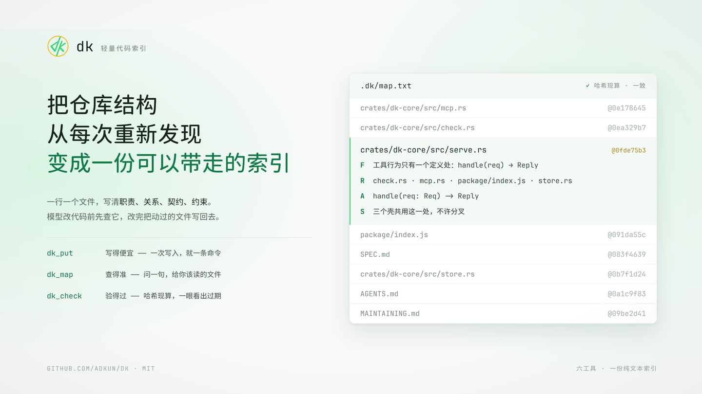

<p align="center">
  <picture>
    <source media="(prefers-color-scheme: dark)" srcset="assets/logo-dark.svg">
    
  </picture>
</p>

<h1 align="center">dk — a lightweight code index</h1>

<p align="center">
  A code index for AI agents: one <code>.dk/map.txt</code> per repository, one line per file,<br>
  capturing four things — <b>responsibility · relations · contracts · constraints</b>. Look it up before you change code; write it back after — <b>no stages, no batches, no approval flow</b>.
</p>

<p align="center"><sub><a href="README.md">简体中文</a> · English</sub></p>

<p align="center">
  <a href="https://github.com/ADkun/dk/actions/workflows/ci.yml"></a>
  <a href="LICENSE"></a>
  <a href="Cargo.toml"></a>
</p>

> Turn "what this repository looks like" from something rediscovered every session into an index you can **carry around and machine-check**.

<p align="center">
  <a href="https://github.com/ADkun/dk/releases/download/v0.3.6/dk-promo.mp4">
    <picture>
      <source media="(prefers-color-scheme: dark)" srcset="assets/promo-cover-dark.png">
      
    </picture>
  </a><br>
  <sub><a href="https://github.com/ADkun/dk/releases/download/v0.3.6/dk-promo.mp4">▶ Watch the 56-second intro</a></sub>
</p>

> **Contents**: [What is dk](#what-is-dk) · [Why use it](#why-use-it) · [Install](#install) · [Quickstart](#quickstart-30-seconds) · [The card](#the-card) · [Six tools](#six-tools) · [CLI](#cli) · [Design trade-offs](#three-hard-boundaries) · [Compared with AOCI](#compared-with-aoci) · [Project layout](#project-layout) · [Self-test](#development-and-self-test) · [License](#license)

## What is dk

dk doesn't read source code for the agent; it answers one question: **which file should I read, and why.**

One plain-text index per repository, `.dk/map.txt`, one line per file, each line capturing four things — **F responsibility, R relations, A contracts, S constraints**.

The loop has exactly three steps:

1. **Before you change code** — `dk_map` finds the files to read for a task; if you already know the path, `dk_get` pulls the full card.
2. **After you change it** — `dk_put` writes the touched files back; source fingerprints are recomputed automatically.
3. **Wrap-up / CI** — `dk_check` runs a full health check: coverage, staleness, dangling cards and broken lines, all at once.

For the exact meaning of the four fields, see [the next section](#the-card).

## Why use it

In a large repo, the bulk of an agent's cost of changing code isn't reading files — it's **finding them**: every session starts from grep and re-derives structure you already figured out.

- **Pain** — traditional schemes (snapshots, baselines, approvals, evidence chains) turn "write a one-line summary" into "run a whole process", so the marginal cost exceeds rereading the source, nobody maintains it, and the index rots.
- **Trade-off** — the marginal cost of a change must stay below the search cost it saves. That is why dk has only six tools, one plain-text index, and one write.
- **Bottom line** — governance strength comes from "cards written accurately + always retrievable + machine-verifiable", not from "proving governance happened".

## Install

dk itself is a CLI; to wire it into a harness, DSH uses a plugin, and other harnesses use MCP. All three wrap the same logic, so you don't configure rules twice.

| What you do | When you need it |
| --- | --- |
| [Install the CLI](#install-the-cli) | First step in every case |
| [Wire into DSH](#wire-into-dsh) | On DSH, to get the six tools under their native names |
| [Register an MCP server](#other-harnesses-mcp) | On any other MCP-capable harness |
| Drop in a `/dk` skill | To add a layer of soft reminders |

### Install the CLI

**From Release (recommended):** grab `dk-v<version>-<target>.zip` from [Releases](https://github.com/ADkun/dk/releases) (tags carry a `v`, e.g. `v0.3.6`), pick the archive for your OS/arch and unzip it, put `dk` / `dk.exe` into any directory on your `PATH`, and verify:

```bash
dk --version
```

**From source:** requires Rust 1.88+ (rustup puts `~/.cargo/bin` on your `PATH`):

```bash
git clone https://github.com/ADkun/dk.git
cd dk
cargo install --path crates/dk --locked
dk --version
```

Just want to try it without touching `PATH`? Run `cargo build --release --locked`; the binary lands at `target/release/dk` (`dk.exe` on Windows).

### Wire into DSH

The plugin does only three things: launch `dk serve` for you, register the native tool names, and append a system prompt. Install the CLI first, then edit your profile:

```text
~/.dsh/profiles/<profile>/package.json
  dependencies:        "dsh-dk": "link:<absolute path to this repo>/package"
  dsh.profile.bundles: append "dsh-dk"
```

Write Windows paths with `/` or escaped double backslashes in JSON — never a bare backslash. Then run `pnpm install` in the profile directory and restart DSH.

Two defaults make it portable across machines:

- `binary` left empty — the plugin first looks for this repo's `target/{release,debug}/dk`, then falls back to `PATH`.
- `root` left empty — it walks up from the session directory to find `.dk/` (then `.git/`), so `cd` into a subdirectory won't split the index.

All options live in [package/README.md](package/README.md).

Also drop in a skill copy, or `/dk` won't take effect inside DSH: copy `skills/dk/SKILL.md` to `~/.dsh/skills/dk/SKILL.md`. It must be a **copy, not a link**; re-sync after editing the repo copy, or the live one silently falls behind.

### Other harnesses (MCP)

No plugin needed: register `dk mcp` as a stdio MCP server. Tool names are under [Six tools](#six-tools); parameters come from MCP `tools/list`. Harnesses name their config fields differently — translate this set of values into their format:

```json
{
  "mcpServers": {
    "dk": {
      "command": "dk",
      "args": ["-C", "<absolute path to the repo root>", "mcp"]
    }
  }
}
```

- `command` may also be `dk.exe` or an absolute path to the binary — anything the harness can launch.
- `-C` is a global option that pins the repo root; you can only omit it if the harness guarantees it starts the server from the repo root — dk never walks up on its own.
- The harness manages the process per the MCP stdio convention; you don't run a service yourself.
- If the harness supports custom skills, `skills/dk/SKILL.md` is plain Markdown — drop a copy into its skill directory per its convention; this step doesn't affect MCP.

## Quickstart (30 seconds)

Once installed (see [Install](#install)), run this from the root of the repo you want to index:

```bash
cd <your-repo>
dk init                                    # create .dk/ and .dkignore, append the managed block to AGENTS.md
dk sweep                                   # list files still missing a card (paths + machine traits only; no source)
echo '{"entries":[{"path":"AGENTS.md","F":"project conventions + dk managed block"}]}' | dk put   # write a card; omit the file to read stdin
dk map "fix the lock race when the session resumes"     # search cards by task; no arg gives the directory tree
dk get AGENTS.md                           # full card + sibling cards + freshness
dk check                                   # full health check; exits 1 when not clean (--json for machines; this is the only command that has it)
```

> **Two easy-to-miss edges**
>
> - The `path` you write must be an **existing, managed** file — that's why we demo with `AGENTS.md`; making up `src/a.rs` when the repo has no such file gets rejected.
> - `dk init` writes `AGENTS.md`, which is itself managed — so in the smallest repo the first `dk check` reports "2 files managed / 1 card / 50.0%". Write a card for the remaining file (or pass `skip:true` to `dk_put`) and it's back to 100% — this isn't a trap, it's what [hard boundary 1](#three-hard-boundaries) demands: no file may silently bypass the index.

On the model side you don't type commands at all: six MCP tools, one call per card.

## The card

```text
<path>@<source-h8>[<tags>]: F:<responsibility> | R:<relations> | A:<contracts> | S:<constraints> #<line-check-h8>
```

| Field | What goes in | Test |
| --- | --- | --- |
| **F** | One-line responsibility | After reading, you can say "what this file does", not "what it has" |
| **R** | Files that must be considered together (comma-separated; may include `database://`) | Change here without looking there and you'll be wrong |
| **A** | External contract: exported signature, CLI args, protocol fields, table schema | Change it and callers must change too |
| **S** | System constraints | Can it be inferred from other fields? Would omitting it cause a wrong change? If the answer to both is yes, leave it out |

Two hashes make the card self-checking:

- The trailing `#h8` — the first 8 chars of this line's blake3; a bad hand-edit fails loudly instead of passing silently.
- `@<source-h8>` — the source fingerprint; `dk check` uses it to detect staleness — no baseline snapshot needed, computed on the spot.

> **A wrong S is worse than a missing S**: an outdated constraint makes the next model decide wrongly, while a missing one only makes it read one more file.

## Six tools

One implementation, three shells (CLI / MCP / DSH plugin) over the NDJSON entry of `dk serve`.

| Tool | What it does | When |
| --- | --- | --- |
| `dk_init` | Create `.dk/` and `.dkignore`, write the AGENTS.md managed block | Once, human-triggered; writes no cards |
| `dk_sweep` | List files still missing a card (paths + machine traits, no source) | Batch through a build-out |
| `dk_map` | Search cards by task; no arg gives the directory tree | **First step before changing code** |
| `dk_get` | Full card by path, plus same-directory siblings and freshness | You already know which file to change |
| `dk_put` | Write cards: `{entries:[{path,F,R,A,S}]}`, hashes computed for you; rename via `from`, delete via `remove`/`skip`, `dry_run` to preview a batch | Write back right after a change |
| `dk_check` | Full health check: coverage, staleness, dangling cards, broken lines, bad R, plus soft-gate warnings and repairable broken lines (`--fix` re-signs in place) | Before wrap-up / in CI |

Here's what a search looks like (dozens of files in this repo; first two cards shown, bodies truncated):

```text
$ dk map "wire the plugin into a profile"
MAINTAINING.md@…: F:maintenance manual: what to sync when you change things, CI and release steps, five known pitfalls | R:… | A:…
Cargo.toml@…: F:workspace: two crates with one release profile | R:crates/dk/Cargo.toml, crates/dk-core/Cargo.toml | A:…
(first card matched 2/3 discriminative query terms: plugin, profile)
```

> Illustrative, translated for readability: `@` fingerprints and card ordering drift with the index, and this repo's real cards are written in Chinese — so a live English query would match nothing and list its words under `absent` (see below). Run `dk map` for the real output. The two cards total ~1k tokens, replacing "open every file and judge which one relates to this change."

> The last line is your evidence of how vague the query was: `confidence` (how the words matched), `matched` (which query terms hit), `absent` (terms this repo lacks) — see [SPEC.md](SPEC.md) for the exact semantics. When a query is off, add `hints` (identifiers from source or error messages) or give `paths` directly; it's far faster than eyeballing candidates.
>
> Phrase the query in English and `absent` will list the English words that don't overlap — the tool doesn't reject English; English words and Chinese cards simply share no terms.

## CLI

```text
init    sweep   check   get   put   map   tokens   serve   mcp
```

- `serve` — NDJSON, one frame per line `{id,tool,args}` → `{id,ok,result|error}` (the DSH plugin and custom harnesses use this)
- `mcp` — MCP stdio server (JSON-RPC 2.0), for direct registration with MCP-capable agents
- `tokens` — report card volume and a token estimate, to judge whether the index has grown too expensive and needs splitting
- `-C <dir>` — pin the repo root, defaulting to the current directory. dk never walks up on its own — walking up is the shell's job (see [package/README.md](package/README.md))

## Three hard boundaries

1. **Coverage is either 100%, or it openly says it isn't finished.** `dk_map`'s task search refuses to return results while N files are still uncarded (unless `allow_partial:true`, and then the header permanently lists what's missing); the directory-tree / by-path / by-directory shapes only answer "what's in the index", without gating or ranking. A partial index is more dangerous than none: it makes people think they've already checked.

2. **No enforced workflow.** One AGENTS.md block, one system-prompt paragraph, one `/dk` skill — three layers of soft reminders, that's it. dk doesn't watch your tool calls, doesn't monitor the filesystem, doesn't hook into compression. A hook would have to enumerate five dimensions — OS × harness × file semantics × read count × compression — and something that can't be fully enumerated can't be trusted; an untrustworthy governance tool is worse than none.

3. **The index is disposable.** Delete `.dk/` and you're simply back to "no index", with no inconsistent half-state left behind.

## Compared with AOCI

Same idea (progressive disclosure: index first, files next), with the process cut down to just writing:

| | [AOCI](https://github.com/ADkun/aoci-code) | dk |
| --- | --- | --- |
| Marginal cost of a small change | rules→…→check: 15 KB response, 7 round-trips | `dk_map`→`dk_get`→`dk_put`: ~1 KB, 1–3 round-trips |
| Resident session cost | ≈ 8.5k tokens | 0 (one `dk_map` ≈ 1k tokens, ephemeral) |
| First build-out | ~2M tokens | Proportional to the number of cards, one at a time |
| Change detection | baseline snapshot + three-layer derived identity + recovery transaction | source blake3 first 8 chars, computed live |
| Governance evidence chain | ledger / receipt / attestation / approval | None. Card and source agree = right; disagree = wrong |

dk doesn't prove "governance happened"; it just makes wrong changes less likely.

## Exclusions

`.dkignore` (`.gitignore` syntax) is the only exclusion declaration, written by a human; the exact paths the tool judges "not worth a card" are appended to a `# dk:proposed` section at the end of the file, which a human can delete wholesale.

Four built-in exclusions:

- Seven directories — `.git` `.dk` `node_modules` `target` `.venv` `__pycache__` `.idea`
- Binary extensions
- Any single file over 1 MiB (a summary shouldn't replace reading a big file)
- `.dkignore` itself

`dist` / `build` / `vendor` are not built in — they mean different things in different ecosystems; write them into `.dkignore` yourself.

## Project layout

```text
crates/dk-core/   all the logic: card format, storage, search, health check, MCP shell
crates/dk/        CLI (argument parsing and output only)
package/          DSH plugin shell (native tool names + built-in launch + a system prompt)
skills/dk/        /dk skill: inject the discipline when a model skips the index
SPEC.md           the single source of truth: card format, tool surface, search, hard gates, three shells
MAINTAINING.md    maintenance manual: what to sync when you change things, CI and release steps
AGENTS.md         root entry for agents: five red lines + eight pre-commit commands
.dk/map.txt       this repo's own index (dogfooding)
scripts/          small release scripts: keep the three versions in lockstep, Release body from SPEC §12
.github/workflows/ CI (three-platform gate) and Release (auto-publish on tag)
```

Tool behavior has exactly **one definition site**: the `handle` function in `crates/dk-core/src/serve.rs`. The CLI, `dk serve`, `dk mcp` and the DSH plugin are all just shells around it; no shell may contain business logic.

## Development and self-test

```bash
cargo test                                 # unit tests
cargo clippy --all-targets -- -D warnings
cargo fmt --check
node scripts/version.mjs                   # the three versions agree (CI's first gate)
node --test package/test/prompt.test.mjs   # plugin-shell unit tests (cargo build first)
node package/test/e2e.mjs                  # plugin-shell e2e: fake ctx runs the real link, 75 assertions
node scripts/check-maintain.mjs            # maintenance consistency: version lockstep / assertion count / doc budget / reference check
dk check                                   # whether this repo's index is consistent (CI's last step)
```

## Releasing and status

Releasing, CI, and "what to sync when you change things" all live in [MAINTAINING.md](MAINTAINING.md) — the single maintenance manual; this page doesn't write a second copy, because two copies always drift.

Early-stage (v0.3.7): the interface is stable, details still move. Sections marked M4 in the spec are **unimplemented design** — don't treat them as current; documenting an unimplemented feature is more dangerous than not documenting it.

## License

MIT, see [LICENSE](LICENSE).
