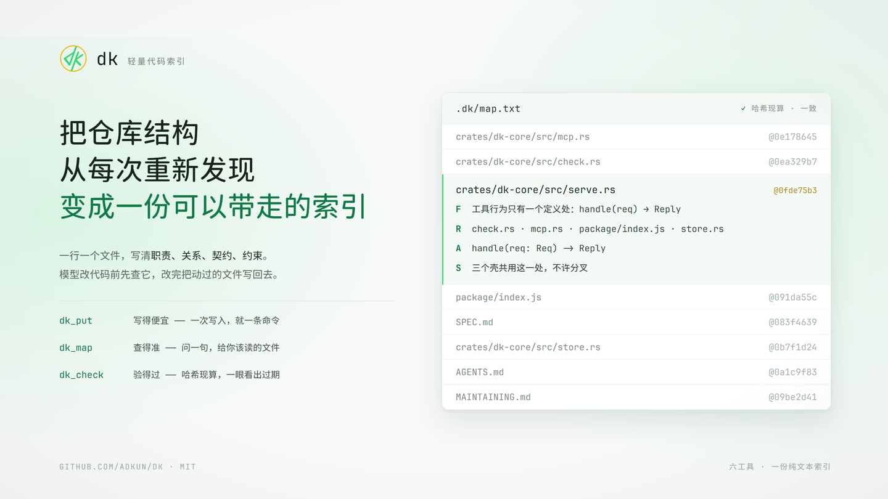

<p align="center">
  <picture>
    <source media="(prefers-color-scheme: dark)" srcset="assets/logo-dark.svg">
    
  </picture>
</p>

<h1 align="center">dk —— 轻量代码索引</h1>

<p align="center">
  一个仓库一份 <code>.dk/map.txt</code>，一行一个文件，写清四件事：<b>职责、关系、契约、约束</b>。<br>
  模型改代码前先查它，改完把动过的文件写回去。没有阶段、没有批次、没有审批流。
</p>

<p align="center">
  <a href="https://github.com/ADkun/dk/actions/workflows/ci.yml"></a>
  <a href="LICENSE"></a>
  <a href="Cargo.toml"></a>
</p>

一句话：**把「这个仓库长什么样」从每次重新发现，变成一份可以带走、可以机检的索引。**

<p align="center">
  <a href="https://github.com/ADkun/dk/releases/download/v0.3.6/dk-promo.mp4">
    <picture>
      <source media="(prefers-color-scheme: dark)" srcset="assets/promo-cover-dark.png">
      
    </picture>
  </a><br>
  <sub><a href="https://github.com/ADkun/dk/releases/download/v0.3.6/dk-promo.mp4">▶ 看 56 秒介绍片</a></sub>
</p>

## 为什么需要它

大仓库里 agent 改一次代码，成本大头不是读文件，是**找文件**：每次会话都从 grep 开始，
把已经弄清的结构再弄清一遍。索引能省掉这部分，但传统方案（快照、基线、审批、证据链）
把「写一行摘要」变成了「跑一遍流程」，边际成本高过重读源码，于是没人维护、索引烂掉。

dk 的取舍只有一条：**一次改动的边际成本必须低于它省下的搜索成本**。
所以它只有六个工具、一份纯文本索引、一次写入；治理强度靠「卡写得准 + 随时可取 + 可机器验证」，
不靠「证明治理发生过」。

## 安装

dk 本体是一个 CLI；接进 Harness 时，DSH 用插件，其它 Harness 用 MCP。三者背后是同一份逻辑，不需要分别配规则。

| 你要做的 | 何时需要 |
|---|---|
| 装 CLI | 所有场景的第一步 |
| 接入 DSH | 用 DSH，想让六个工具以原生名出现 |
| 注册 MCP | 用其它支持 MCP 的 Harness |
| `/dk` 技能 | 想要一层软提醒；DSH 需要单独放一份副本 |

### 装 CLI

从 Release 装（推荐）：到 [Releases](https://github.com/ADkun/dk/releases) 下载形如 `dk-v<版本>-<target>.zip` 的包（tag 带 `v`，例如 `v0.3.6`），按系统/架构挑好后解压，把 `dk` / `dk.exe` 放进 `PATH` 里的任一目录，验证：

```bash
dk --version
```

从源码装：需要 Rust 1.88+（rustup 会把 `~/.cargo/bin` 放进 `PATH`）：

```bash
git clone https://github.com/ADkun/dk.git
cd dk
cargo install --path crates/dk --locked
dk --version
```

只想临时试跑、不写进 `PATH`：`cargo build --release --locked`，二进制在 `target/release/dk`（Windows 是 `dk.exe`）。

### 接入 DSH

插件只做三件事：内置拉起 `dk serve`、注册原生工具名、追加一段系统提示词。先按上面装好 CLI，二进制查找顺序见下，再改 profile：

```text
~/.dsh/profiles/<profile>/package.json
  dependencies:        "dsh-dk": "link:<本仓库绝对路径>/package"
  dsh.profile.bundles: 追加 "dsh-dk"
```

Windows 路径写 `/` 或 JSON 里转义后的双反斜杠，别用单个裸反斜杠。然后在 profile 目录 `pnpm install`，重启 DSH。

两个默认值让换机器也能跑：`binary` 留空先找本仓库的 `target/{release,debug}/dk`，再走 `PATH`；`root` 留空会从会话目录向上找 `.dk/`（其次 `.git/`），`cd` 进子目录也不会分裂索引。全部配置项见 [package/README.md](package/README.md)。

再放一份技能副本，DSH 里的 `/dk` 才会生效：把仓库的 `skills/dk/SKILL.md` 复制到 `~/.dsh/skills/dk/SKILL.md`。必须是**复制，不是链接**；改了仓库那份之后要重新同步，否则线上那份会静默落后。

### 接入其它 Harness（MCP）

不用插件：把 `dk mcp` 注册成一个 stdio MCP server 即可，工具名见下面的「六个工具」，参数由 MCP `tools/list` 给出。各 Harness 的配置字段名不同，按它的格式翻译这一组值：

```json
{
  "mcpServers": {
    "dk": {
      "command": "dk",
      "args": ["-C", "<仓库根目录的绝对路径>", "mcp"]
    }
  }
}
```

- `command` 写 `dk.exe` 或二进制绝对路径也行，只要 Harness 能拉起它。
- `-C` 是全局选项，固定仓库根；只有当 Harness 保证以仓库根作为工作目录启动 server 时才能省略——dk 自己不上溯。
- 进程由 Harness 按 MCP stdio 约定管理，不需要自己起服务。
- 若 Harness 支持自定义技能，`skills/dk/SKILL.md` 是普通 Markdown，按它的技能目录约定放一份即可；这一步不影响 MCP。

## 30 秒上手

装好后（见 [安装](#安装)），在要索引的仓库根跑：

```bash
cd <你的仓库>
dk init                                    # 建 .dk/ 与 .dkignore，并往 AGENTS.md 追加受管块
dk sweep                                   # 看还差哪些文件没建卡（只列路径与机器特征，不读源码）
echo '{"entries":[{"path":"AGENTS.md","F":"项目约定与 dk 受管块"}]}' | dk put   # 写卡；省略文件读 stdin
dk map "改会话恢复时的锁竞争"               # 按任务检索卡片，无参给目录树
dk get AGENTS.md                           # 取全卡 + 同目录兄弟 + 新鲜度
dk check                                   # 全量体检；不干净时 exit 1（--json 给机器读，只此一条命令有）
```

写入的 `path` 必须是**已存在且受管**的文件，所以上面拿 `AGENTS.md` 演示（它一定在）；
随手编一个 `src/a.rs` 而仓库里没有这个文件，会被拒。

`dk init` 会写 `AGENTS.md`，而它同样是受管文件——所以在最小的仓库里（`AGENTS.md` + 一个源文件）
第一次 `dk check` 报「受管 2 文件 / 1 张卡 / 50.0%」。给剩下那个文件写卡（或 `dk_put` 传 `skip:true`）就回到 100%。
这不是坑，是硬边界 1 要的：没有文件能悄悄绕过索引。

模型侧就不用敲命令了：六个 MCP 工具（见下），一张卡一次调用。

## 卡片长什么样

```text
<path>@<源码h8>[<tags>]: F:<职责> | R:<关系> | A:<契约> | S:<约束> #<行校验h8>
```

| 字段 | 内容 | 判据 |
|---|---|---|
| **F** | 一句话职责 | 读完能说出「这文件干什么」，而不是「它有什么」 |
| **R** | 必须一起考虑的文件（逗号分隔，可含 `database://`） | 改这里而不看那里就会错 |
| **A** | 对外契约：导出签名、CLI 参数、协议字段、表结构 | 它一变，调用方就得变 |
| **S** | 系统约束 | 写前自问两句：能从其它字段推出来吗？不写会导致改错吗？都能就别写 |

行尾 `#h8` 是这一行正文的 blake3 前 8 位：手改坏了当场报错，不静默通过。
`@<源码h8>` 是源码指纹，`dk check` 用它判过期——不需要基线快照，指纹现算。

**错的 S 比缺的 S 更有害**：一条过期约束会让下一个模型做出错误决定，而缺一条只会让它多读一次文件。

## 六个工具

一份逻辑，三个壳（CLI / MCP / DSH 插件）共用 `dk serve` 的 NDJSON 入口。

| 工具 | 干什么 | 何时用 |
|---|---|---|
| `dk_init` | 建 `.dk/` 与 `.dkignore`，写 AGENTS.md 受管块 | 人触发一次，不写卡 |
| `dk_sweep` | 列出还没建卡的文件（路径 + 机器特征，不带源码） | 建库时按批推进 |
| `dk_map` | 按任务描述检索卡片；无参给目录树 | **改代码前第一步** |
| `dk_get` | 按路径取全卡，附同目录兄弟与新鲜度 | 已知要改哪个文件 |
| `dk_put` | 写卡：`{entries:[{path,F,R,A,S}]}`，哈希由工具现算 | 改完立刻写回 |
| `dk_check` | 全量体检：覆盖率、过期、失联、坏行、坏 R | 收工前 / CI 里 |

一次真实调用（本仓库几十个文件，这里节选两条，卡片正文有截断）：

```text
$ dk map "插件壳怎么装到 profile"
Cargo.toml@dfde79f8: F:工作区：两个 crate 与统一 release 档 | R:crates/dk/Cargo.toml, crates/dk-core/Cargo.toml | A:…
.github/workflows/ci.yml@8867ba1d: F:CI：三平台 fmt / clippy / test / build + 插件壳端到端 + 本仓库索引自检 | …
（首张卡命中 1/3 个有判别力的查询词：profile）
```

这两条完整卡合计约 1 k token（3.0 B/token 的估法），替掉的是「把每个文件挨个打开，
判断哪个与这次改动相关」。`@` 后是源码指纹，每次 `dk_put` 都会变——分不清真假时用 `dk check` 现算。

最后那行是**这次问法有多虚**的凭据：七个词里只有三个有判别力（本仓到处都有的词不进分母），
而这三个里只踩中 `profile` 一个——说明卡片里不这么说话。

换成英文问 `how do I install the plugin into a profile`，同一行会变成
`（首张卡命中 1/2 个有判别力的查询词：profile；另有 5 个词本仓没有：how、do、the、plugin、into）`
——**不是工具不认英文，是英文单词与中文卡片本来就没有重叠**，`absent` 把这一点直接说出来，
而不是让你以为自己问法不好。这时候补 `hints`（放源码/报错里的标识符，比如
`cordis.patch.yml`、`ctx.inject`），或已知要动哪个文件就直接 `paths`，比挨个看候选猜哪个对快得多。
`confidence` 同理：`surface` 只说「词面是对上的」，从不说「答案在里面」。

## CLI

```
init    sweep   check   get   put   map   tokens   serve   mcp
```

- `serve`：NDJSON，一行一帧 `{id,tool,args}` → `{id,ok,result|error}`（DSH 插件与自建 harness 走这个）
- `mcp`：MCP stdio 服务器（JSON-RPC 2.0），给支持 MCP 的 agent 直接注册
- `tokens`：统计卡片体量与 token 估算（判断索引是否已经贵到该拆）
- `-C <dir>`：指定仓库根，默认当前目录。`dk` 自己不上溯——上溯是壳的职责（见 [package/README.md](package/README.md)）

## 三条硬边界

1. **覆盖要么 100%，要么明说没建完**。`dk_map` 的**任务检索**在还差 N 个文件时拒绝返回结果
   （`allow_partial:true` 才给，且结果头部永久标出缺哪些）。目录树 / 按路径 / 按目录这三种形状
   查询只回答「索引里有什么」，不拦也不排序。部分索引比没有索引更危险：它让人以为查过了。
2. **不做流程强制**。AGENTS.md 一块、系统提示词一段、`/dk` 技能一个——就这三层软提醒。
   技能副本怎么放、为什么要复制而不是链接，见「安装 / 接入 DSH」；dk 不看你的工具调用、
   不监听文件系统、不挂压缩钩子。钩子要穷举 OS × harness × 文件语义 ×
   读次数 × 压缩五个维度，不可穷举即不可信，而不可信的治理工具比没有更糟。
3. **索引是可删的**。删掉 `.dk/` 只会让你回到「没有索引」，不会留下不一致的半成品。

## 与 AOCI 的关系

思想同源（渐进式披露：先给索引，再给文件），流程砍到只剩写入：

| | [AOCI](https://github.com/ADkun/aoci-code) | dk |
|---|---|---|
| 一次小改动的边际成本 | rules → overview → maintain → update_entry → verify → check（15 KB 响应、7 个往返） | `dk_map` → `dk_get` → `dk_put`（约 1 KB、1–3 个往返） |
| 会话常驻 | 索引分块 + AGENTS 块 + 工具 schema ≈ 8.5 k token | 0（一次 `dk_map` ≈ 1 k token，用完即走） |
| 第一次建库 | 200 万 token 级 | 与卡片数成正比，一次一张 |
| 变化判定 | baseline 快照 + 三层派生身份 + recovery 事务 | 源码 blake3 前 8 位，现算 |
| 治理证据链 | ledger / receipt / attestation / 审批 | 无。卡与源码一致就是对，不一致就是错 |

dk 不证明「治理发生过」，只让改错的机会变少。

## 排除规则

`.dkignore`（`.gitignore` 语法）是唯一的排除声明，人写在上面；
工具判定「不值得建卡」的精确路径追加到文件末尾的 `# dk:proposed` 分节，人可整段删除。

内置排除四类：七个目录（`.git` `.dk` `node_modules` `target` `.venv` `__pycache__` `.idea`）、
二进制扩展名、**单个大于 1 MiB 的文件**（大文件不该用摘要代替阅读）、以及 `.dkignore` 自身。
`dist` / `build` / `vendor` 不内置——不同生态含义不同，请自己写进 `.dkignore`。

## 项目结构

```text
crates/dk-core/   全部逻辑：卡片格式、存储、检索、体检、MCP 壳
crates/dk/        CLI（只做参数与输出）
package/          DSH 插件壳（原生工具名 + 内置拉起 + 一段提示词）
skills/dk/        /dk 技能：发现模型跳过索引时，强制注入纪律
SPEC.md           唯一权威规格：卡片格式、工具面、检索、硬门、三壳
MAINTAINING.md    维护手册：改了东西要同步哪几处、CI 与发版怎么操作
AGENTS.md         给 agent 的根入口：五条红线 + 提交前八条命令
.dk/map.txt       本仓库自己的索引（dogfooding）
scripts/          发版用的小脚本：版本三处同号、Release 正文取自 SPEC §12
.github/workflows/ CI（三平台门禁）与 Release（打 tag 自动发版）
```

工具行为只有一个定义处：`crates/dk-core/src/serve.rs` 的 `handle`。CLI、`dk serve`、`dk mcp`、
DSH 插件都只是它的壳，任何壳里都不许出现业务判断。

## 自测

```bash
cargo test                          # 单元测试
cargo clippy --all-targets -- -D warnings
cargo fmt --check
node scripts/version.mjs            # 版本号三处同号（CI 的第一道就是它）
node --test package/test/prompt.test.mjs   # 插件壳单元测试（需先 cargo build）
node package/test/e2e.mjs           # 插件壳端到端：fake ctx 跑真链路，75 条断言
node scripts/check-maintain.mjs     # 维护一致性：版本同号 / 断言总数 / 文档预算 / 引用可查
dk check                            # 本仓库索引是否一致（CI 最后一步就是它）
```

## 发版（维护者）

发版、CI、以及「改了东西要同步哪几处」，都在 `MAINTAINING.md`——那边是唯一一份维护手册，
这里不写第二份：两处维护必然对不上（v0.2.7 的 Release 正文分叉就是这么来的）。

## 状态

早期版本（v0.3.6），接口已稳定、细节仍会动。规格里标了 M4 的章节是**未实现的设计**，
不当现状用——文档写未实现的实现，比缺文档更危险。

## License

MIT，见 [LICENSE](LICENSE)。
